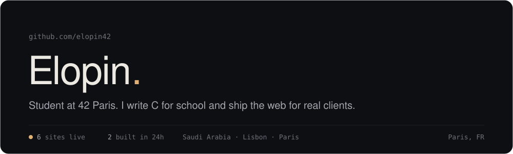
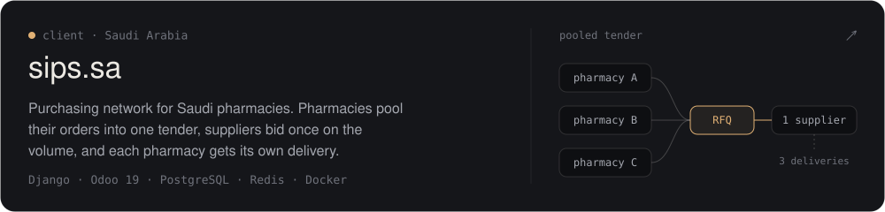
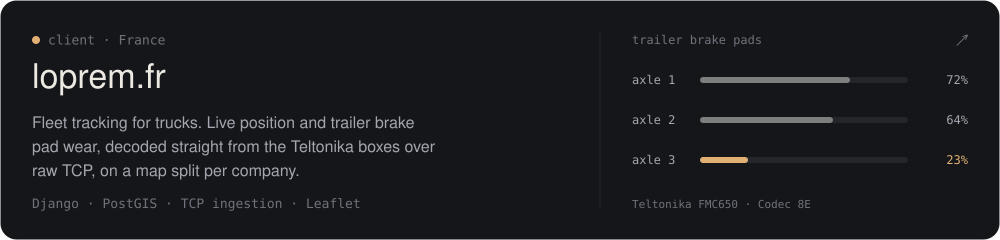
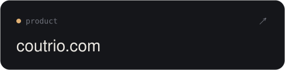
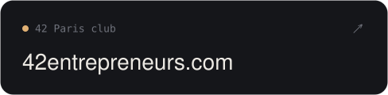
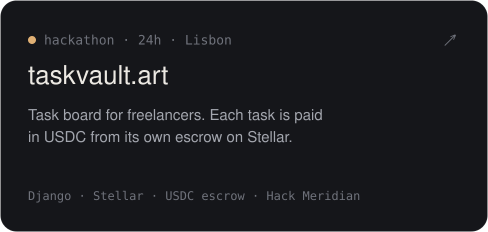
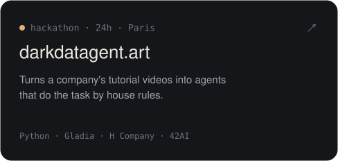

 

I study at 42 Paris, where everything is C, C++ and a shell. Outside school I build web products that real people use: a purchasing network for pharmacies in Saudi Arabia, brake wear telemetry for truck fleets, and two hackathon projects shipped in 24 hours.

### Shipped

### At 42

[minishell](https://github.com/elopin42/minishell) · [cub3d](https://github.com/elopin42/cub3d) · [philosophers](https://github.com/elopin42/philosopher) · [ft_irc](https://github.com/elopin42/irc) · [inception](https://github.com/elopin42/inception) · [ft_transcendence](https://github.com/elopin42/ft_transcendence) · [ft_malcolm](https://github.com/elopin42/ft_malcom)

A shell, a raycaster, a deadlock puzzle, an IRC server, a Docker stack and a multiplayer web app. The low level stuff is why my web code knows what happens under it.

On the side: [dank-retro-viseur](https://github.com/elopin42/dank-retro-viseur), a rear-view mirror for my desktop. One click and the webcam shows who is behind me.

### Tools

`C` `C++` `Python` `TypeScript` · `Django` `Odoo` `Next.js` `three.js` · `PostgreSQL` `PostGIS` `Redis` · `Docker` `Linux` `Git`

### Contact

[ethan@42entrepreneurs.com](mailto:ethan@42entrepreneurs.com) · [LinkedIn](https://www.linkedin.com/in/eth-lop) · [Linktree](https://linktr.ee/elopin) · [DevGlobe](https://devglobe.app/developers/elopin42)
